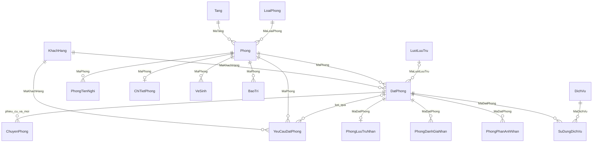

# Quan hệ dữ liệu đơn giản

Các FK đơn được khai báo trực tiếp cạnh cột trong file01/02. Java kiểm tra thêm các mã khách/phòng/phiếu thuộc cùng nguồn. Danh sách review một/phiếu được kiểm tra bởi service, không phải UNIQUE SQL trong bản đơn giản.
